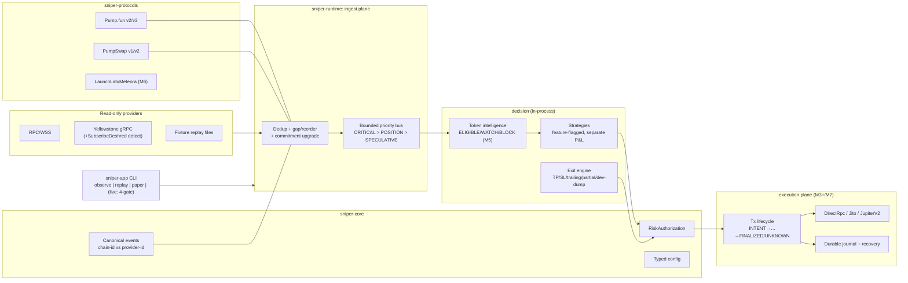

# Architecture — Solana Sniper Fusion

Status: M0 (as-designed; evolves per milestone). Rust-native trading daemon; Python (chainstack) is a frozen offline test oracle only — never a runtime dependency.

## Crates (functional four-first; decompose later when interfaces stabilize)

| Crate | Owns | Hard rules |
|---|---|---|
| `sniper-core` | Dual event identity (`ChainEventId` = chain-truth signature/outer/inner/event-ordinal; `ProviderObservationId` = provider+stream+receipt), commitment levels, wall-clock + monotonic timestamps, schema versions, integer newtypes (Lamports/Microlamports/TokenAmount/Bps, checked math), error taxonomy, typed config, `RiskAuthorization` | No I/O, no async runtime dep, no network. Everything else depends on core; core depends on nothing internal |
| `sniper-protocols` | Venue + program-ID registry, instruction decoders/builders per protocol version, account-layout tables, quote math (i128 signed reserves) | Pure functions over bytes/accounts; validated against official IDL tables (`docs/PROTOCOL_COMPATIBILITY.md`) + fixtures |
| `sniper-runtime` | observe/replay/paper runtimes, priority bus, dedup/gap/reorder handling, blockhash cache, provider capability detection, ingestion adapters (RPC/WSS/gRPC), journal persistence interface, kill switch | Observer+replay hold **no broadcaster/signer capability** (type-enforced). Overload sheds SPECULATIVE only |
| `sniper-strategy` | S00–S10 policies; Engine A (LegacySurrogateV1 surrogate) + Engine B (protocol quote on observed reserves/fees, abstains when unobserved); on-chain-observed fee schedules (curve, PumpSwap tiered); independent double-entry P&L oracle; full-portfolio evaluator + 12 negative controls (H7/PF1) | No synthetic fallback presented as real; unobserved reserves/fee tiers ⇒ abstain; receipts deterministic and permanently non-promotable |
| `sniper-app` | CLI, mode composition, tracing+redaction, metrics endpoints | `live` subcommand requires: `live` cargo feature (non-default) ∧ operator authorization token ∧ validated budget config ∧ kill-switch check |

`sniper-strategy` was extracted ahead of plan at H7 (2026-11-04). Remaining later decomposition (M5+): `sniper-intelligence`, `sniper-positions`, `sniper-storage` — extracted when their interfaces freeze, driven by compile-time coupling evidence, not the target diagram.

Adjacent planes (never linked into `crates/`): `harness/` — Python research tooling (G0 collector, H8 registry, evaluator CLI, labs, tests); `integrations/harness2` — the Google Harness² integration (ADR-0012, deterministic channel only, model-backed BLOCKED).

## Event architecture

- Every decoded chain fact carries: `ChainEventId { signature, outer_ix_index: u32, inner_ix_index: Option<u32>, event_ordinal: u16 }`, venue, program, slot, commitment, `received_wall: SystemTime`, `received_mono: Instant`, source stream id, schema version.
- Same chain event arriving via logs+geyser+replay dedups on `ChainEventId` (venue-scoped); provider observation metadata is retained separately for latency attribution.
- Commitment model: `Processed → Confirmed → Finalized` upgrade-in-place; fork rollback reverts unconfirmed state and flags affected positions for reconciliation.
- Gap policy: detected slot gap on a CRITICAL stream → **halt new entries**, reconcile positions, resume on recovery. Speculative-stream gaps → mark candidate data stale (`WATCH`).

## Priority bus

Three tiers, bounded queues; on overflow: SPECULATIVE drops (counted, exported), POSITION blocks briefly then sheds oldest non-critical, CRITICAL never dropped (backpressure propagates to providers).

## Transaction lifecycle (order ≠ position)

`INTENT → AUTHORIZED → SIGNED → SUBMITTED → OBSERVED → FINALIZED | FAILED | UNKNOWN(→RECONCILING)`. Ack/bundle-id ≠ landed: fills update only after signature-verified execution + balance delta. Persist intent + signature identity before submission; crash-recoverable at every stage; submission dedup across workers/restarts. Position states: `OPEN / SELL_PENDING / PARTIALLY_EXITED / CLOSED / RECONCILING`.

## Risk authorization

`RiskAuthorization { strategy_id, mint, venue, spend_limit, fee_cap, tip_cap, slippage_bps, max_price_impact, valid_from_slot, valid_to_slot, nonce }` — constructed only by the risk engine after checks pass; consumed by execution which re-validates bounds at build time. Copy-trading, strategies, and emergency exits all route through it; bypass is unrepresentable (execution accepts only authorized intents).

## Hot-path exclusions

No DB writes, social/metadata fetches, wallet-history analysis, or LLM calls inside detect→sign. Verified-fact cache carries `{value, as_of_slot, fetched_at, source, ttl}`; stale mandatory safety facts ⇒ `WATCH`/`BLOCK`, never silent approval.

## Testing surfaces

Unit (core/protocols) → LiteSVM instruction execution (M3) → fixture differential vs chainstack oracle (M2/M4) → replay harness (M8) → fault-injection (M7) → Criterion benchmarks. Details in `docs/TEST_PLAN.md`.

## Explicit non-goals (this codebase)

No microservices/IPC split; no leveraged/perp products; no L1 generalization beyond Solana; no browser/UI in the trading plane; no automatic mainnet activation.
