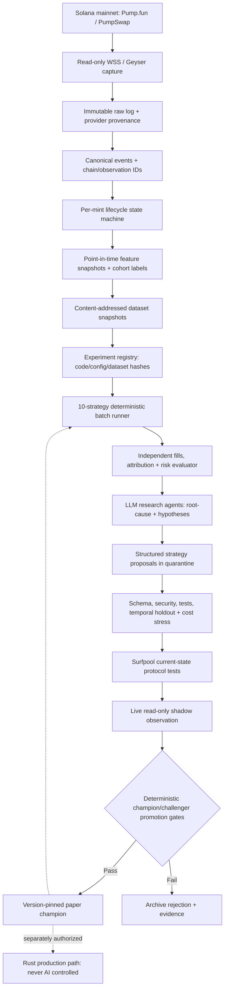

# SniperFusion AI Strategy Research Harness — Architecture V1
Date: 2026-11-03 | Status: DESIGN/RESEARCH ONLY | Baseline main: bf694d6fbf1d9b9834c8f0bded192649994ebf8a

## 0. Goal and strict separation
Build a closed-loop research platform that produces *proposed and reproducibly tested* strategy configurations or deterministic policy code from historical, fork and shadow data. Maximize **out-of-sample after-cost risk-adjusted return**, not synthetic win rate. This document is NOT a claim of implemented functionality.

- **Hot path (Rust, deterministic):** immutable event intake -> canonical decode -> point-in-time features -> hard safety verdict -> selected immutable strategy -> risk authorization -> order construction -> optional authorized execution -> reconciliation -> durable ledger.
- **Cold path (research harness):** complete token lifecycle observation -> datasets -> candidate hypotheses (LLM optional) -> deterministic experiment compilation -> batch evaluation -> independent audit -> fork tests -> real-time shadow -> paper promotion.
- AI has **no signer, broadcaster, live risk budget escalation, secret access, or ability to change live strategy configs**. Treat datasets, GitHub issue text, token metadata, social content, and LLM responses as untrusted input.
- Strategy code/config is versioned, pinned by digest and signed off via separate promotion policy. Never automatically activate funded mainnet trading.

## 1. Existing baseline (verified code)
- Four crates: sniper-core, sniper-protocols, sniper-runtime, sniper-app.
- `harness/snf-harness` H4 has doctor/verify/replay/fork/shadow/evaluate/compare/promote and write-once manifests; shadow is a deliberate NOT_STARTED stub; compare is arithmetic only, promote is a presence gate.
- `ReplayRunner::run` publishes all inputs then drains strict priority tiers, breaking event-time order. Fix before trading backtests. Need chronological domain processing + priority only for overload shedding.
- `PaperBroker::settle_sell` pairs global `open_entries.remove(0)`, not by mint; correct FIFO **per mint, per strategy, per lot** and support partial fills/exits.
- `PaperBrokerConfig::default` assumes 100-bps fee and 70ms fixed landing, while fees and latency are regime- and venue-dependent. Config only wires buy slippage to paper broker. Explicitly model actual fee-config, sell-side slippage, rent and volume accumulator effects.
- H2 `evaluate_paper.py` evaluates closed trades only: add portfolio equity, unrealized P&L, outstanding/unknown orders, cash limits, missed entries and full-loss write-offs.
- M3c verified local Pump.fun buy_v3 and sell_v3 on pinned Surfpool; exposed user-volume-accumulator settlement and TradeEvent interpretation questions. Live CLI intentionally refuses (M7).
- H3 seven-day read-only shadow is not implemented.

## 2. Architectural diagram

## 3. Dataset / provenance contracts
Store raw capture and canonical events separately; use Parquet + DuckDB for offline analytics, compact JSONL for interop; raw records with append-only hash-chain or object digests. SQLite is sufficient for experiment registry on one host, upgrade only if scale demands it.

- `raw_observation`: provider_id, subscription/filter, received_wall_ns, received_monotonic_ns, slot, commitment, signature, raw payload hash, ingestion_seq, stream_gap_flag.
- `chain_event`: chain_event_id(signature, outer_ix, inner_ix, event_ordinal, venue), mint, creator, slot, tx_index/position when known, transaction outcome, event kind, decode_version, exact amounts, account deltas, program_id, IDL hash.
- `mint_lifecycle`: created_at, curve-live, halted-on-completion, migrated/pool-live, stalled, inactive, ended/censored, protocol version, SOL/USDC/pump-token quote path, mayhem/cashback variants.
- `feature_snapshot`: mint, strategy_time_event, available_at_ns, observed_at_ns, slot_asof, verified confidence, reserve/fee/depth, buyers/sellers, funded cluster stats, authority/extension checks, reason codes; no future labels.
- `market_label`: future outcome, label_horizon, complete_observation_until, raw provenance, missing/censor flags; only accessible to evaluator.
- `order_intent`, `order_attempt`, `fill`, `position_lot`, `balance_delta`, `fee`, `candidate_decision`, `strategy_run` preserve all submitted AND skipped/cancelled actions with reason codes.
- Ensure `event_time <= provider_observed <= model_features_available <= decision_time <= send_time`; provider clock skew may invalidate wall timestamps, so preserve all raw clocks and explicitly flag unverifiable ordering.
- `mint_id` not just token symbol. Token-paired quote-chain metadata matters. A position is identified by wallet+mint+venue and lot/strategy attribution.

## 4. Complete lifecycle states and cases
1. DISCOVERED: creation ix / create_v2 and possibly initial creator buy in same transaction. Capture launch mode, quote mint, true program ownership, inherited token program and metadata.
2. INITIAL_TRADING: first successful trade, initial creator/in-group holdings, buyer cohort and immediate sells.
3. BONDING_CURVE_ACTIVE: exact virtual/reserve balances, fees, buy/sell flows, unique funded buyer clusters, age, executable sell depth, progress and quote-currency conversions.
4. PRE_COMPLETION: remaining real token reserves, crossing-buy estimate, failure and incomplete execution hazard.
5. SYNTHETIC_COMPLETION: v3 crossing buy can emit TradeEvent -> CompleteEvent -> PostCompleteBuyEvent, producing two distinct priced legs within one transaction. Must account both, not double count.
6. CURVE_COMPLETE_POOL_PENDING: curve trades may fail with BondingCurveComplete while migration pending. Explicit no-trade gap and position management.
7. MIGRATED / POOL_OPEN: PumpSwap pool init, correct pool accounts, fees, negative i128 virtual_quote_reserves, initial virtual/real reserves and post-migration quote.
8. POST_MIGRATION: survival, divergence, secondary liquidity, fee tiers and potential delist/near-zero exit.
9. INACTIVE / RUG / CENSORED: distinguish no future trades from collector gaps and still-active observations. Do not equate lack of graduation with complete loss; model actual executable exit.
10. Special: instant bundled graduation, mayhem launch, cashback fallback (v2), pump-coin/USDC quote, multi-hop, Token-2022 extensions, spoofed social metadata, failed trade, fork rollback, transfer hooks and missing ATA.

## 5. Exactly comparable multi-strategy experiments
Define a batch spec with `batch_id, cohort_hash, selection_policy, observation_window, split_spec, common initial_cash, fee/latency model, scenario_seeds, candidate_configs[10]`. Each candidate runs the same events, same clock and same available information; use separate identical virtual wallets for standalone ranking. Then rerun strategies competing against a **single shared global wallet** to measure portfolio capital contention.

Initial families (not proof of alpha): **ten trade candidates plus a mandatory abstention baseline**.
S00 NO_TRADE baseline; S01 INSTANT_SAFE; S02 WAIT_5S; S03 WAIT_15S; S04 UNIQUE_BUYERS+NET_FLOW; S05 DIP_REBOUND; S06 DEV_FLOW_NEGATIVE_FILTER; S07 CURVE_PROGRESS; S08 PRE_GRADUATION; S09 POST_GRADUATION; S10 LIQUIDITY_BREADTH_CONFIRMATION. Treat S00 as a separate non-trading benchmark; selective wallet confirmation is a later extension, not counted in the first batch. Each has config hash, hypothesized mechanism, phase eligibility, reason codes, and preregistered expected benefit. Test exits independently with explicit factorial design or hold a single common exit policy to isolate entry changes.

Test on all detected launches including dead/stalled tokens, stratified by creation mode, liquidity, quote coin, week/hour, creator clusters and market regime. Use a time-ordered train/dev/holdout split, **purged/embargoed** for overlapping labels and cluster leakage. One-time sealed holdout, no repetitive tuning. A run of 10 variants on a single synthetic fixture does not prove profitability.

## 6. Economic evaluation and stats
- Replay is an event-time **as-observed** simulation, NOT historical perfect-order reconstruction or MEV-accurate fill guarantee; no future reserves known at decision.
- Simulate distribution of feed delay, decision time, build delay, queue + landing, landed/reverted/expired probability, competing buys, tip/priority and account creation, quote version, fee config, price impact, migration gaps.
- Report pessimistic, central and optimistic execution bounds with **measured** assumptions; run adverse latency+slippage stress and zero-fill sensitivity.
- Account cash, position cost basis, reserved/locked rent, in-flight orders, withdrawable vs claimable proceeds, executor fees, network+tips, realized+unrealized P&L, max drawdown, tail loss, exposure duration, failure rates, per-phase/per-cohort attribution.
- Report raw and equal-risk-adjusted gains over no-trade and current champion, bootstrap **by mint/creator cluster/day** (not individual trades), block bootstrap over time, confidence intervals, sample counts, probability of ruin, and multiple-hypothesis correction (e.g. FDR/holdout governance).
- Normalize comparisons by initial capital, risk and opportunity availability. Different strategies have different trade counts and risk, so absolute P&L alone is insufficient.
- Treat strategy economic improvement as UNDETERMINED with insufficient sample / wide uncertainty; don't assert an edge.

## 7. AI agent roles and hard tool boundaries
- **Market Archaeologist**: cite primary Pump IDL/docs, token lifecycle cohort and selection bias, detect schema/fee drift.
- **Protocol/Smart-Contract Auditor**: IDL/program/ATA/PDA, synthetic migration, Token-2022 extensions, fork-economics reconciliation.
- **Quant Researcher**: features, causal hypotheses, experiment preregistration, OOS performance and calibrated costs.
- **Adversarial Researcher**: creator concentration, bundle activity, manipulation, spoofed metadata, failure adversaries.
- **Runtime & Security Reviewer**: chronological replay, no-lookahead, no-signer boundary, latency and journal correctness.
- **Independent Skeptic/Evaluator**: falsification attempts; not the same agent that proposed the strategy.
LLM can read **sanitized, aggregated** run evidence and source-code diffs. It emits a proposal document + narrowly typed strategy candidate JSON or PR, never executable shell input or unsigned arbitrary code embedded in trade signals. Compile/review untrusted generated code in network-isolated sandboxes with resource caps. No prompt content from metadata can override gates.

## 8. Promotion gates
G0 Data: no unexplained collection gaps, coverage report, hash pins, complete cohort denominator.
G1 Code/Security: fmt, clippy, deny, secrets, property/fuzz, approval; no live capability in research workers.
G2 Simulator: chronological replay, mint-matched accounting, independently reconciled equity, no future leakage.
G3 Statistical: preregistered metric improvement with enough mint/day clusters, uncertainty interval excluding zero or accepted risk bound, no exploit of eval bugs. Explicitly record multiplicity.
G4 Protocol: fork program matches exact instruction and account deltas on both entry and exit and special variants.
G5 Shadow: >=7 continuous observed days + longer reserved out-of-sample period before trusting alpha; record live feed gaps and estimated vs observed prices.
G6 Operations: kill-switch, stale-data blocks, budget limits, fault injection and crash-recovery.
G7 Promotion: **paper-only** immutable champion config after all gates. Funded trading is a separate manual authorization path; cannot be triggered by the LLM or harness.

## 9. Implementation roadmap
P0 correctness: chronological domain replay, per-mint/lot FIFO, portfolio equity, explicit fee/latency semantics; regression tests that fail before fix and pass after.
P1 lifecycle observer: integrate read-only WSS + optional Geyser with versioned raw event store, daily coverage/gap checks, mint state machine, creation cohort ledger.
P2 research contracts: immutable dataset and candidate schemas, `snf-harness dataset`, `batch`, `report`, `diagnose`; fix H4 `compare` to enforce same cohort and sample units.
P3 strategy plugin: pure Rust `on_event`/snapshot -> typed `NO_TRADE/WATCH/BUY/EXIT`, with provenance; 10 candidates in isolated virtual portfolios and shared-wallet re-evaluation.
P4 independent evaluator: mark-to-exit equity, clustered uncertainty, latency/slippage stress, adversarial corpus, comparison against no-trade.
P5 AI offline orchestration: structured inputs/outputs, hypotheses/preregistration, quarantine, independent code review, cost budget and run tracking.
P6 real shadow: H3 >=7 day window, multiple provider parity, model-vs-execution diagnostics, monitoring drift and circuit-breaker evidence.
P7 migration + complex venue fork parity, release hardening, explicitly separate live go/no-go.

Proposed new files (not implemented): `crates/sniper-strategy`, `crates/sniper-research` (pure deterministic Rust); `harness/schemas/{batch,run,proposal,decision,token_lifecycle}.json`, `harness/research/orchestrator.py` (offline only), `harness/strategies/*.toml`, `harness/reports/` gitignored. Avoid unnecessary microservice splitting.

## 10. Key reference documents
- Existing code: docs/PROJECT_STATUS.md, docs/evidence/H2.md, docs/evidence/H4.md, docs/evidence/M3c.md; harness/snf-harness; crates/sniper-runtime/src/{runner,broker}.rs.
- Official protocol source: https://github.com/pump-fun/pump-public-docs (particularly TRADE_V3.md, SYNTHETIC_MIGRATION.md, PUMP_SWAP_TRADE_V2.md, CREATE_WITH_PUMP_COIN_QUOTE.md).
- Official runtime/landing: https://solana.com/docs/tools/transaction-landing and https://docs.jito.wtf/lowlatencytxnsend/.
- Independent source for market-cohort validation: https://hiddenhand.trade/research/pump-fun-graduation-rate (2026-11-02 snapshot, not verified by this repo).
- Academic risk context: https://discovery.ucl.ac.uk/id/eprint/10220651/.
- Bias benchmark: https://www.freqtrade.io/en/stable/lookahead-analysis/.
- **Data caveat**: arXiv/SSRN RED-PUMP-2026 work disclosed a postpublication 6-minute collector window limitation; do not quote its original 0.198% as a reliable 24-hour graduation rate without discussing corrections.
